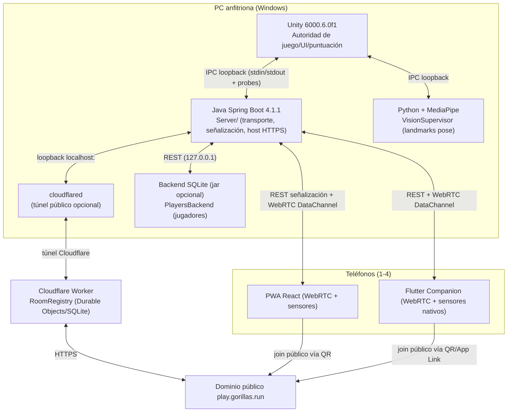
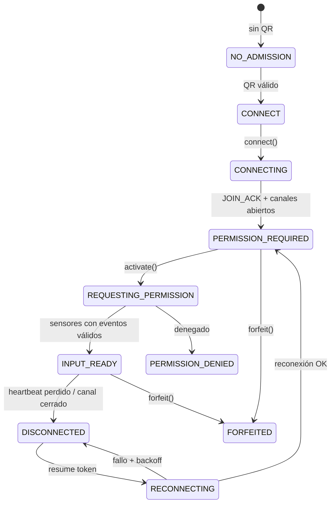

# 01 — Arquitectura, responsabilidades y puntos de fallo

Laboratorio: LAB-20261103-121446

## 1. Diagrama de componentes

## 2. Comunicación real entre procesos

| Par | Mecanismo | Protocolo | Notas |
|---|---|---|---|
| Unity ↔ Java | IPC loopback (subproceso Java supervisado por `JavaProbeSupervisor`), frames JSON con `ProbeCodec` | ping/pong + comandos | Unity es dueño del lifecycle |
| Unity ↔ Python (visión) | IPC loopback (`VisionSupervisor` → `worker.py`/`pipeline.py`) | landmarks JSON | MediaPipe pose |
| Java ↔ PWA/APK | REST (señalización) + WebRTC DataChannel (input) | JOIN/JOIN_ACK, HELLO/HEARTBEAT/ACK, UI_COMMAND, MOTION_SAMPLE | control = fiable; motion = no ordenado, maxRetransmits 0 |
| Java ↔ Backend jugadores | HTTP loopback `127.0.0.1:<port>` | GET/POST `/api/players` | opcional, un solo intento (sin reintento de escritura) |
| Java ↔ cloudflared | subproceso + HTTP local | túnel quick | ruta pública opcional |

## 3. Estados de conexión (cliente móvil)

## 4. Flujo de un jugador

1. PC arranca → Unity muestra splash/menú → `Bootstrap` prepara Java, visión, conectividad.
2. Anfitrión ve QR (dominio público o LAN).
3. Jugador escanea QR → PWA/APK obtiene `sessionId`+`admission`.
4. Cliente hace `POST /mobile/join` (señalización REST) → `JOIN_ACK` con `playerId` 1–4, `peerId`, `resumeToken`.
5. Se establecen DataChannels `control` (fiable) y `motion` (no ordenado).
6. Jugador acepta permisos de sensores → envía `MOTION_SAMPLE`/`UI_COMMAND`.
7. Unity interpreta input → gameplay → publica `gameContext` (puntuación/fase) por ACK.
8. Resultados → pantalla final; desconexión/reconexión con `resumeToken`.

## 5. Inicio y cierre

- **Inicio**: `Unity.exe` → `Bootstrap`/`PackagedRuntimeEnvironment` localiza binarios empaquetados → lanza `JavaProbeSupervisor` (Java) y `VisionSupervisor` (Python) como subprocesos supervisados → UI progresa a menú.
- **Cierre**: Unity termina → supervisores matan subprocesos y descendientes (`ParentLifetime`, `ManagedProcessGuard`); `PlayersBackend.destroy()` cierra proceso y descendientes.

## 6. Matriz de responsabilidades

| Responsabilidad | Unity | Java | PWA/APK | Python visión | Worker | Backend |
|---|---|---|---|---|---|---|
| Reglas/puntuación/autoridad | ✅ | ❌ | ❌ | ❌ | ❌ | ❌ |
| Transporte/sesión técnica | ❌ | ✅ | ❌ | ❌ | ❌ | ❌ |
| Captura input sensores | ❌ | ❌ | ✅ | ❌ | ❌ | ❌ |
| Detección de pose | ❌ | ❌ | ❌ | ✅ | ❌ | ❌ |
| Registro de salas públicas | ❌ | ❌ | ❌ | ❌ | ✅ | ❌ |
| Persistencia jugadores | ❌ | (supervisa) | ❌ | ❌ | ❌ | ✅ |
| Contratos compartidos | Shared/ | Shared/ | — | — | — | — |

## 7. Puntos únicos de fallo (SPOF)

1. **Unity** — si el proceso principal cae, todo cae (aceptado por diseño: autoridad única).
2. **Java** — sin él no hay señalización ni RTC; mitigado con supervisión/reinicio (verificar).
3. **cloudflared** — si el túnel público es la única vía y cae, no hay join remoto (hay fallback LAN).
4. **WebRTC sin TURN** — NAT simétrico/aislamiento de clientes puede impedir P2P; no hay TURN (límite declarado).
5. **Cámara/MediaPipe** — un solo pipeline para los 4 cuerpos; si se pierde, el juego dependiente de cámara se degrada.
6. **RoomRegistry (Durable Object)** — si el Worker no responde, el registro público falla (hay ruta local).
7. **Puerto IPC/JVM** — un solo puerto loopback; si lo ocupa otro proceso, el arranque falla (verificar manejo).

## 8. Duplicación / código paralelo observado

- Dos clientes móviles: PWA (React) y Companion (Flutter) — **intencional** (dos entregables), pero deben mantener paridad de contrato.
- `Assets/Scripts/*Controller.cs` (minijuegos alpha de Saúl) conviven con `Assets/_Project/Scripts/Input/*` (adaptador Fase 0) — **integración en curso**, no duplicación muerta; requiere verificación de que no haya dos autoridades de input.
- `BowlingHybridEnvironment.cs` vs `BowlingController.Environment.cs` — posible solapamiento a inspeccionar.
