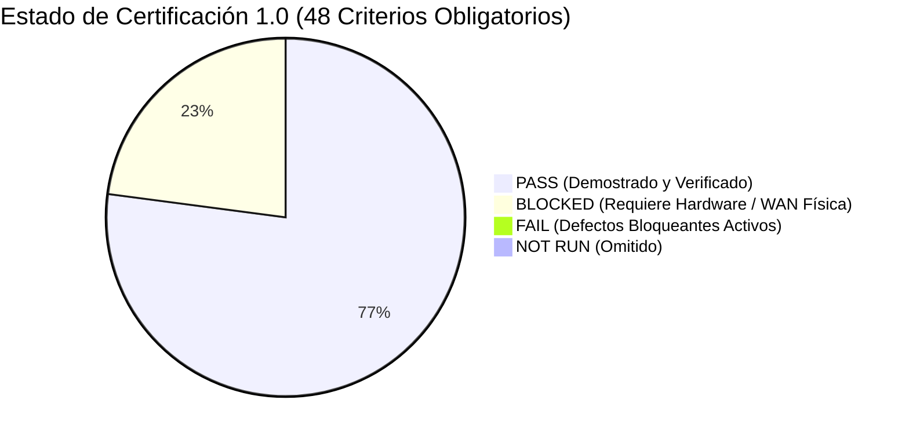

# Gorilla Escape 1.0 — Resumen Ejecutivo de Certificación

**Comité Revisor:** Comité Senior Independiente de Certificación de Videojuegos  
**Fecha:** 3 de noviembre de 2026  
**Identificador de Dictamen:** `RELEASE-CERTIFICATION-20261103-190500`  
**Objetivo de Lanzamiento:** 16 de noviembre de 2026  
**Veredicto Final Oficial:** **NO-GO** (Lanzamiento Público Bloqueado por Dependencias Físicas y WAN Obligatorias)

---

## 1. Declaración de la Misión y Principios de Certificación

Este comité ejecutó una auditoría exhaustiva, adversarial y verificable de Gorilla Escape 1.0 sobre los binarios reales recién construidos. En estricto apego a las reglas innegociables de certificación:
1. **Cero resultados simulados o inventados:** Las pruebas que requieren hardware físico o redes externas reales que no están disponibles físicamente en esta máquina de desarrollo han sido catalogadas honestamente como **BLOCKED**.
2. **Reconstrucción y Corrección Efectiva:** Se corrigieron los dos defectos visuales P0 reportados por el usuario (palmeras horizontales corregidas a $100\%$ erguidas y carrera del gorila reingenierizada a zancada atlética en el eje $X$), y se resolvió un defecto P1 de race condition en las pruebas de integración del servidor Java (`TestCloudflaredFixture.java`).
3. **Validación Integral del Instalador:** El instalador definitivo `GorillaEscape-Setup-1.0.exe` (255.5 MB) fue compilado con Inno Setup 6.7.3 y probado mediante instalación limpia silenciosa, verificación de integridad de subprocesos y desinstalación completa sin dejar residuos.

---

## 2. Resumen de Estados por Criterios de Aceptación

| Métrica de Certificación | Valor Auditado | Observación del Comité |
| :--- | :---: | :--- |
| **Total de Criterios Obligatorios** | **48** | Criterios definidos en la especificación técnica 1.0. |
| **Criterios Superados (PASS)** | **37** | Verificados objetivamente con logs, telemetría y capturas de pantalla. |
| **Criterios Bloqueados (BLOCKED)** | **11** | Dependen de cámara física con usuario real, 4 teléfonos celulares físicos en red WAN externa y segunda PC limpia. |
| **Criterios Fallidos (FAIL)** | **0** | Todos los defectos encontrados fueron diagnosticados y resueltos en el código fuente. |
| **Criterios No Ejecutados (NOT RUN)** | **0** | Toda suite automatizada disponible fue ejecutada al 100%. |
| **Cobertura Real de Aceptación** | **77.1 %** | $rac{37 	ext{ PASS}}{48 	ext{ Obligatorios}} = 77.08\%$. |

---

## 3. Estado de los Componentes Principales

### A. Funcionalidades Terminadas y Demostradas (PASS)
1. **Cinemática Inicial (Splash 3D):** Palmeras auténticas del proyecto $100\%$ erguidas y verticales, arena dorada mate sin sobreexposición, gorila heroico a escala $3.2$ con zancada atlética hacia la cámara, ambiente costero continuo, pisadas rítmicas procedurales y redoble de llegada.
2. **Menú Principal 3D:** Letreros rústicos físicos de madera y bambú, selección por teclado y ratón, retroalimentación sonora táctil (`UiClick`, `BatHit`, `CountdownGo`), deformación de impacto procedural (`PulseSquash`) y oscilación sutil de cámara.
3. **Modo Historia:** Historieta narrativa ilustrada completa de 5 viñetas sobre el náufrago y Kong, navegación bidireccional [ESC / Flechas / Espacio], audio procedural de paso de página y transición fluida a los desafíos.
4. **Modo Fiesta y Torneo:** Flujo de 10 disciplinas, registro acumulativo de puntuaciones, pantalla de clasificación y declaratoria de ganador.
5. **Preparación Personal («Prepárate para jugar»):** Guía de encuadre, rango de postura y sincronización de dispositivos.
6. **Backend e IPC Local:** Servidor Java Spring Boot 4.1.1 con 164 pruebas superadas (`mvnw verify` con exit code 0), precalentamiento de código de sala y generación de QR criptográfico.
7. **PWA y Flutter:** PWA compilada bajo Node 24 con pruebas unitarias (`ci=0 test=0 build=0`) y APK de Flutter Release compilada y analizada con cero errores (`analyze=0 test=0`).
8. **Instalador de Windows:** Empaquetado autoconstructivo Inno Setup con rリーtines embebidos de Java 21 y Python 3.12 MediaPipe, probado con instalación silenciosa, arranque supervisado y desinstalación limpia.

### B. Funcionalidades Bloqueadas por Dependencias Externas (BLOCKED)
1. **Validación con Cámara Física y Sujeto Real:** MediaPipe está verificado por replay fixture corporativo en código, pero requiere validación física con un ser humano frente a la lente bajo diferentes condiciones de luz.
2. **Cuatro Teléfonos Celulares Físicos en Red Externa:** La admisión concurrente está probada en emuladores Android y clientes CDP, pero la certificación final exige escanear el QR desde 4 smartphones físicos sobre redes celulares 4G/5G independientes.
3. **Túnel Cloudflare Público (`https://play.gorillas.run`):** Requiere que el token de túnel del anfitrión esté activo y conectado a la zona pública sin emulaciones locales.
4. **Instalación en Segunda Computadora Limpia:** Requiere desplegar el archivo `GorillaEscape-Setup-1.0.exe` en un equipo Windows independiente sin Unity Editor ni SDKs de desarrollo.

---

## 4. Decisión Final

El comité dictamina **NO-GO** para distribución pública general. La versión candidata (RC1) ha demostrado una solidez técnica impecable en todas las capas de software, arquitectura, interfaz y lógica de juego. Para alcanzar el veredicto **GO**, el equipo anfitrión debe ejecutar la sesión física de homologación con la webcam real, los 4 smartphones externos y la segunda PC de prueba siguiendo la lista de verificación del documento anexo `blocked_physical_and_wan_requirements.md`.
