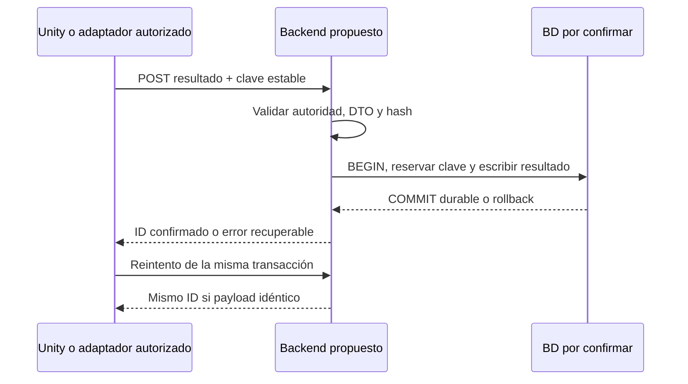

# API real y contratos de negocio propuestos

Última revisión: 2026-10-16. Fuentes: S1, S2 y S3; identificadores definidos en [inventario de fuentes](../00-product/SOURCE_INVENTORY.md). Las etiquetas describen el alcance indicado, no una certificación global.

API real S1, condicionada por configuración: `HealthController`, `MobileController`, `TrustOnboarding`. No es una API SQL de jugadores/resultados.

| Método / ruta existente | Función / acceso |
|---|---|
| GET /api/health | Salud técnica; no prueba persistencia |
| POST /mobile/admission | Operador local autenticado, genera admisión/QR; puede responder 503 si red no está lista |
| POST /mobile/join | Oferta RTC/admisión; devuelve respuesta e identidad técnica; rechazos 400 |
| POST /mobile/reconnect | Reanudación con credencial/identidad; rechazo 400 |
| POST /mobile/disconnect | Cierra peer validado; rechazo 400 |
| GET /mobile/diagnostics; POST /mobile/end | Operador local autenticado; diagnósticos y cierre |
| GET /prepare; GET /gorilla-root.cer | Guía/certificado local; acceso HTTP sólo durante recuperación explícita |

`PublicIngress` restringe rutas públicas: no expone admission/diagnostics/end/prepare/IPC. Configuración de escucha y TLS determina el origen; no publicar endpoints de operador como API abierta. Los payloads de señalización están en MobileRuntime/MobileController; no duplicar SDP real en documentación.

Todo lo siguiente es **PROPUESTO, NO IMPLEMENTADO**. No llamar estas rutas hasta confirmar backend, versión y autorización.

| Método / ruta candidata | Caso de uso | Respuesta propuesta |
|---|---|---|
| GET /api/v1/minigames | Catálogo real | 200 lista con code/rulesVersion |
| GET /api/v1/players | Listado académico, paginado | 200 participantes humanos |
| POST /api/v1/players | Alta validada autorizada | 201, 400 validación, 409 conflicto |
| POST /api/v1/game-sessions | Abrir competición persistente | 201 sesión; no token RTC |
| POST /api/v1/matches | Registrar partida autorizada | 201 identificador durable |
| POST /api/v1/matches/{matchId}/results | Publicar resultados finales Unity | 201 primera vez, 200 replay idéntico, 409 misma clave/datos distintos |
| GET /api/v1/matches/{matchId}/results | Consulta UI | 200 resultados oficiales confirmados |

Ejemplo ilustrativo de POST de resultado (identificadores ficticios, no contrato wire RTC):

```json
{
  "transactionId": "11111111-1111-4111-8111-111111111111",
  "matchId": "22222222-2222-4222-8222-222222222222",
  "sessionPlayerId": "33333333-3333-4333-8333-333333333333",
  "minigameCode": "COCONUT_THROW",
  "rulesVersion": "propuesta-1",
  "score": 12.34,
  "unit": "m",
  "attempts": [{"ordinal": 1, "valid": true, "value": 12.34}]
}
```

El header candidato `Idempotency-Key` debe igualar transactionId y permanecer estable al reintentar. Es un ejemplo parcial de un resultado, no certifica cumplimiento de tres intentos de Shot Put. El contrato definitivo debe definir cuándo admite partida incompleta, nulidad por falta y cálculo de mejor intento. Falta credencial del publicador: una PWA sin autorización nunca puede fijar puntuaciones oficiales.



Confirmar errores con requestId, código y detalle sanitizado, límites de tamaño, CORS por origen real, expiración/roles y política de reintentos. 401/403/409 no se reintentan indefinidamente; red/5xx admiten backoff limitado. HTTP 200 de una demo o de health no demuestra INSERT SQL.
