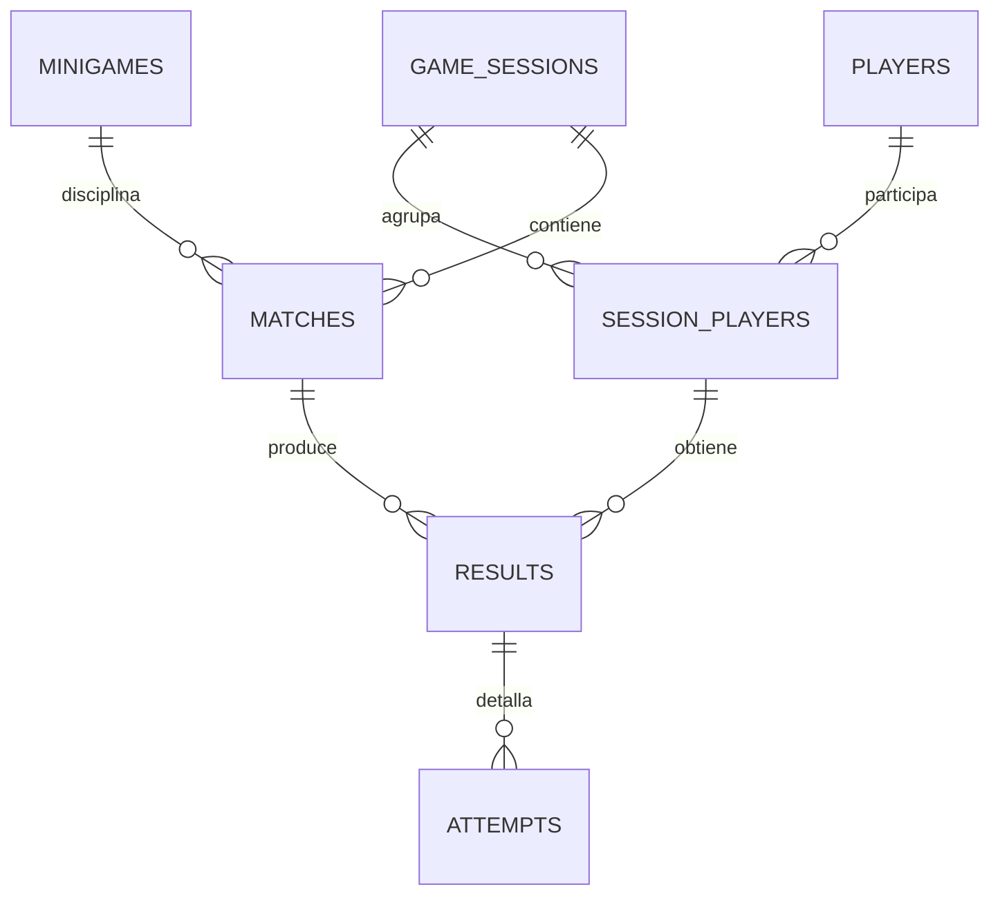

# Modelo relacional propuesto

Última revisión: 2026-10-16. Fuentes: S1, S2 y S3; identificadores definidos en [inventario de fuentes](../00-product/SOURCE_INVENTORY.md). Las etiquetas describen el alcance indicado, no una certificación global.

**Implementado en S9:** SQLite/JDBC y migración V1 de `players(id TEXT PK, display_name TEXT, created_at TEXT)`, tabla STRICT con constraints; UUID/fecha generados por backend. [Migración real](https://github.com/Josue1855/Gorilla-Escape-Backend/blob/3635186/src/main/resources/db/migration/V1__create_players.sql). No existe inactive_at ni modelo de sesiones implementado.

**El modelo de competición siguiente sigue PROPUESTO.** Sus tipos son lógicos; no son el DDL instalado. Los fixtures JSON del protocolo no son tablas persistidas.

| Entidad | Campos candidatos / constraints |
|---|---|
| players | id UUID PK, display_name requerido y acotado, created_at UTC, inactive_at nullable; sin correo/contraseña necesarios para el MVP |
| game_sessions | id UUID PK, state enumerado, created_at, ended_at nullable; ended_at >= created_at |
| session_players | id UUID PK, session_id FK, player_id FK, slot entero 1..4; UNIQUE(session_id,player_id), UNIQUE(session_id,slot), UNIQUE(id,session_id) |
| minigames | id UUID PK, code UNIQUE, display_name, rules_version requerida; códigos de las cuatro disciplinas aprobadas |
| matches | id UUID PK, session_id FK, minigame_id FK, rules_version snapshot, state, started_at, ended_at; UNIQUE(id,session_id), fechas coherentes |
| results | id UUID PK, match_id, session_id, session_player_id, score numérico finito, unit, rank nullable, transaction_id UUID UNIQUE, payload_hash, recorded_at; FK compuesta(match_id,session_id) y FK compuesta(session_player_id,session_id); UNIQUE(match_id,session_player_id) para un resultado final por participante |
| attempts | id UUID PK, result_id FK, ordinal entero >0, valid boolean, metric y unit según disciplina/rulesVersion, value nullable, foul_code nullable; UNIQUE(result_id,ordinal), inválido sin valor puntuable; almacenar sólo cuando aporta auditoría de reglas |

Las FKs compuestas impiden registrar un participante de otra sesión. No basta validar en frontend. Reglas por disciplina y número de intentos se validan en backend dentro de la misma transacción; decidir si hacen falta constraints/triggers tras elegir motor. Los récords se derivan de resultados por rulesVersion/unidad, evitando otra autoridad de puntuación. Correcciones de resultados deberían generar revisión auditada, no sobrescritura silenciosa; su modelo queda pendiente.

Idempotencia PROPUESTA: reservar transaction_id UNIQUE y hash del payload canónico en la misma transacción de resultado/intentos. Primera escritura hace COMMIT; replay idéntico devuelve el ID existente; mismo ID con contenido distinto produce conflicto sin mutar datos. Solicitudes concurrentes se arbitran por restricción única y manejo transaccional, no sólo por consulta previa. Si se admite transacción para más de un agregado, proponer tabla de recibos separada antes de extender este esquema.

Unity genera la semántica de resultado; un adaptador autenticado conserva el ID al reintentar. El backend valida dominio, pertenencia a sesión y autorización. PlayerId entero RTC/epoch no es players.id: el mapeo explícito sesión técnica↔participante durable aún no existe y debe acordarse.

Retención PROPUESTA: ambiente académico separado con datos ficticios por runId; limpieza explícita de intentos→resultados→partidas→relaciones→sesiones→jugadores, sin borrar catálogos compartidos ni producción. Duración del histórico/retención de claves y solicitud de eliminación requieren decisión del PO antes de liberar. El recibo de idempotencia debe sobrevivir al máximo período de replay para evitar duplicados tras limpieza. No hay plazo aprobado que documentar como existente.

No almacenar cada lectura de giroscopio, touch ni fotograma en SQL; preservar sólo resultados/intentos útiles. En S9 existen scripts reales de jugadores `scripts/sql/seed.sql`, `query.sql` y `cleanup.sql`, documentados en el [laboratorio backend](https://github.com/Josue1855/Gorilla-Escape-Backend/blob/3635186/docs/LAB_PLAYERS.md). No son scripts para las entidades futuras de competición.
