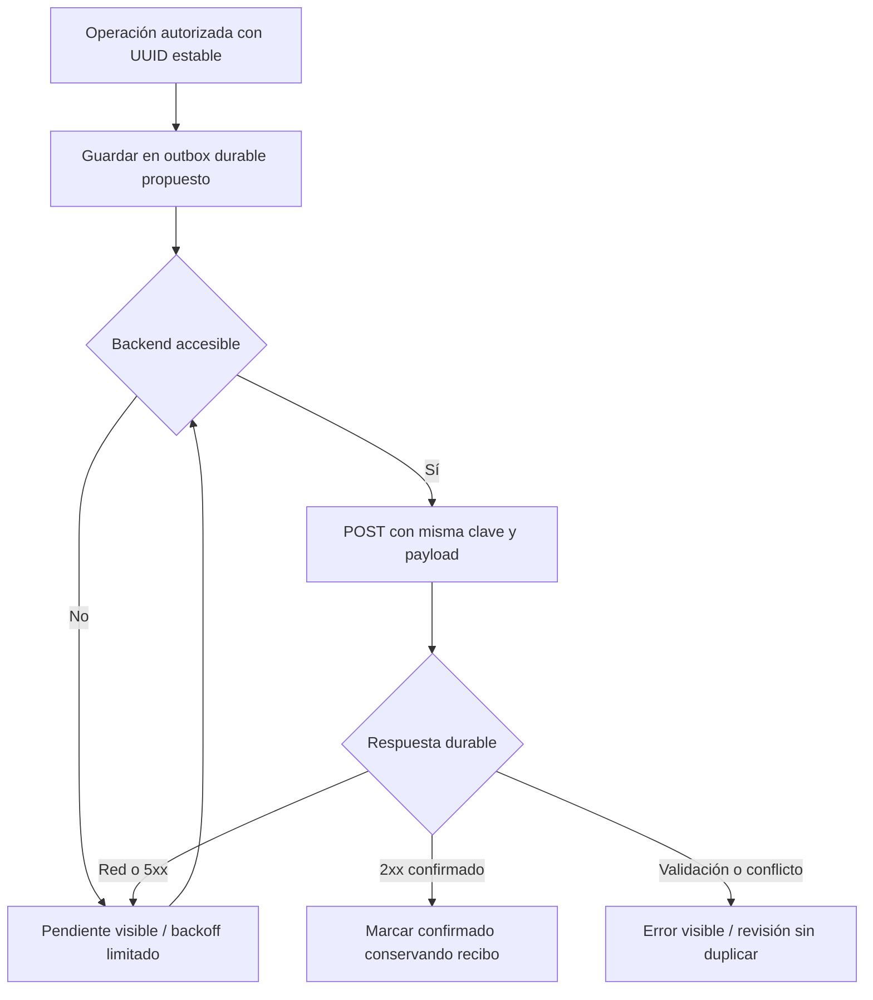

# Offline LAN y transacciones

Última revisión: 2026-10-16. Fuentes: S1, S2 y S3; identificadores definidos en [inventario de fuentes](../00-product/SOURCE_INVENTORY.md). Las etiquetas describen el alcance indicado, no una certificación global.

| Condición | Comportamiento actual | Diseño futuro / prueba |
|---|---|---|
| WAN desconectada, LAN activa | S1 tiene CABIN/WebRTC host y recursos locales; Software/Lab S2 | T019/T020 deben demostrarlo en hardware; backend local puede seguir accesible |
| Backend local inaccesible, LAN activa | No backend de negocio integrado | UI distingue error del backend y evita éxito ficticio; conservar operación autorizada si hay cola durable |
| Wi-Fi/LAN perdida | Transporte técnico falla y requiere recuperación manual | No se envía gameplay retrospectivo ni se rehace una partida como si continuara |
| Shell previamente cacheado | Monorepo tiene SW generado; S4 tiene fallos de dist | Probar instalación/caché real, actualización y recarga; no garantizar primera visita sin recursos |

La demo JSONPlaceholder de S4 devuelve caché o competidores de rescate. Son datos simulados; no equivalen a backend LAN, identidad real, BD ni sincronización de POST. No hay IndexedDB/cola durable encontrada en S1/S4.

Flujo de negocio **PROPUESTO**; sólo encolar operaciones aprobadas. Un resultado oficial necesita outbox Unity/adaptador durable, o una delegación autorizada explícita: no confiar sólo en IndexedDB del teléfono ni dejar que éste fabrique puntuación.

Decidir propietario de la cola, capacidad/caducidad, orden por agregado, cierre de sesión con pendientes, conflictos, versión de payload y borrado de caché. `navigator.onLine` es una pista, no una sonda de disponibilidad REST. No cachear respuestas de error como éxito, tokens de admisión ni certificados privados. Background Sync no se presume disponible: prever botón de sincronización y reintento con app abierta, y validar navegadores físicos.
