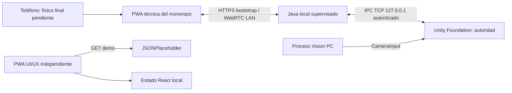
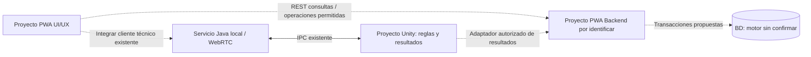

# Arquitectura actual y objetivo

Última revisión: 2026-10-16. Fuentes: S1, S2 y S3; identificadores definidos en [inventario de fuentes](../00-product/SOURCE_INVENTORY.md). Las etiquetas describen el alcance indicado, no una certificación global.

AS-IS: las flechas continuas del canal técnico tienen implementación y evidencia Software/Lab S1/S2. El tramo físico final conserva el bloqueo T019. La PWA UI/UX independiente sólo modifica estado local y consulta JSONPlaceholder; no está integrada.

El Spring Boot de Java local aloja la PWA compilada, admite teléfonos y administra WebRTC. No tiene esquema SQL/JPA encontrado. Cloudflared es bootstrap HTTPS opcional; no convierte el input en juego remoto ni transporta la física. La cámara PC tiene supervisión propia; no se agrega un servidor de inferencia nuevo en esta tarea.

TO-BE: conexiones discontinuas PROPUESTO, integración entre proyectos PLANIFICADO, backend/BD DESCONOCIDO. No se reemplaza el servicio técnico por el backend de persistencia.

Responsabilidades: Unity calcula resultados; Java transporta y supervisa conectividad; UI/UX representa estado y captura intenciones; backend valida, autoriza y persiste; BD garantiza integridad. Tres proyectos de equipo no equivalen a tres procesos: el runtime actual incluye Unity, JVM y Vision. [Contratos](API_CONTRACTS.md), [red](NETWORK_AND_IPC.md) y [plan de integración](../03-development/INTEGRATION_PLAN.md).
