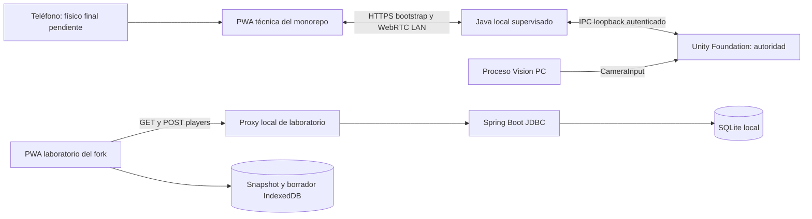
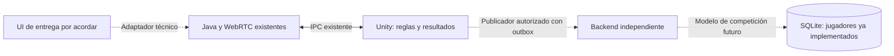

# Arquitectura actual y objetivo

Última sincronización: 2026-10-16. Fuentes S9/S10 y evidencia fechada; [inventario](../00-product/SOURCE_INVENTORY.md). Trabajo documentado en ramas/PR, no integrado automáticamente.

Hay dos flujos implementados con alcances distintos: canal técnico Software/Lab S1/S2 y laboratorio de persistencia S9/S10 en ramas para revisión. La incorporación al producto distribuido sigue pendiente.

El Java técnico aloja el cliente RTC y administra conectividad; no se le atribuye el esquema SQL del backend independiente. El proxy Node loopback4173 y backend8090 son herramientas ejecutadas en el laboratorio, no un nuevo supervisor ni distribución final. SQLite no expone puerto a LAN. Unity calcula reglas y resultados; REST de jugadores no transporta controles.

Integraciones pendientes:

Outbox, autorización, sesiones/resultados/rankings e instalador autocontenido requieren tareas posteriores. [Contratos](API_CONTRACTS.md), [red](NETWORK_AND_IPC.md) y [offline](OFFLINE_STRATEGY.md) conservan estas fronteras.
