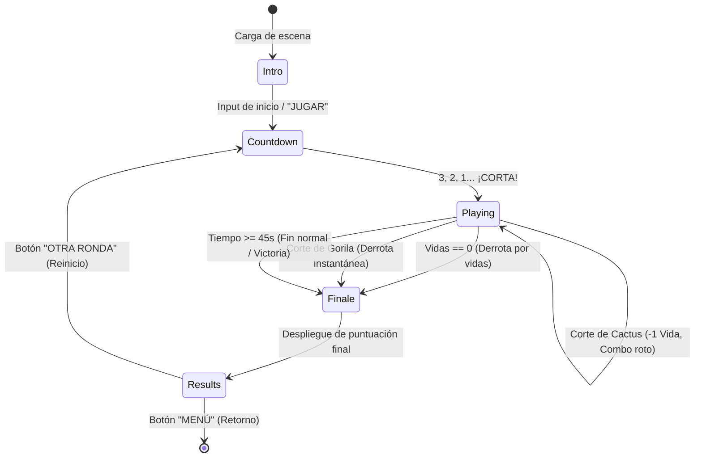

# Evidencia de Aprendizaje — Unidad 2 (35%)
## Implementación y Documentación de Mecánicas Principales en Unity con Programación Orientada a Objetos y Componentes

**Institución:** Universidad Tecnológica (IDGS102N)  
**Proyecto:** *Gorilla Escape: Gorilimpiadas*  
**Versión de Unity:** `Unity 6000.6.0f1 (Unity 6)`  
**Entorno:** 3D (Simulación de física tridimensional con proyección y cámara en perspectiva/ortográfica)  
**Fecha:** Octubre 2026  
**Equipo de Trabajo y Roles:**  
- **Josué Galván:** Implementación de mecánicas centrales, arquitectura de componentes, gestión de estados y control de ciclo.  
- **Saúl:** Revisión de código, integración de escenas, assets 3D y pruebas de límites.  

---

## 1. Propósito y Objetivo de la Mecánica

### 1.1 Contexto en el MVP
*Gorilla Escape: Gorilimpiadas* es un videojuego interactivo de minijuegos arcade ambientado en una jungla gobernada por gorilas. En el marco del MVP evaluable, la disciplina insignia analizada es **Coconut Slice** (complementada transversalmente con la arquitectura desacoplada de **Log Balance** y **Banana Bowling**). 

### 1.2 Objetivo Central de la Mecánica
El objetivo del jugador en **Coconut Slice** es cortar en el aire la mayor cantidad de cocos proyectados balísticamente para acumular puntaje y encadenar combos multiplicadores, mientras evita rebanar obstáculos peligrosos (cactus con espinas) y preserva intacto al gorila bebé dormido. 

La mecánica establece un **ciclo de interacción completo** donde los reflejos del jugador determinan la supervivencia mediante un sistema estricto de vidas y un cronómetro de ronda, garantizando una experiencia de juego reproducible, desafiante y libre de inconsistencias en el registro de colisiones.



---

## 2. Secuencia Formal de Comportamiento

El ciclo interactivo obedece a un flujo lineal y determinista en 5 fases:

$$\text{Acción del Jugador} \longrightarrow \text{Evento del Motor} \longrightarrow \text{Regla de Juego} \longrightarrow \text{Cambio de Estado} \longrightarrow \text{Respuesta Visual/Sonora}$$

| Paso | Denominación | Detalle Técnico en *Gorilla Escape* |
| :--- | :--- | :--- |
| **1** | **Acción del jugador** | El usuario realiza un desplazamiento rápido con su mano o cursor en pantalla sobre la zona de corte de un objeto al vuelo. |
| **2** | **Evento** | Detección del vector de desplazamiento $(\Delta x, \Delta y)$ con velocidad superior al umbral (`speed > 0.72`) y emisión de la acción de entrada `SliceLeft` o `SliceRight` validada por `MotionSession` y `JungleGameplayInput`. |
| **3** | **Regla de juego** | Cálculo de intersección geométrica entre el segmento de corte del jugador $[\vec{A}, \vec{B}]$ y la posición espacial del proyectil 3D: $\text{distancia}(\vec{P}, \text{segmento}) < 0.075$. Se evalúa si el objeto es un coco estándar, un cactus (peligro) o el gorila protegido (derrota súbita). Se valida el cerrojo atómico anti-doble corte (`!coconut.sliced`). |
| **4** | **Cambio de estado** | - **Coco:** `sliced++`, `combo++`, `bestCombo = Max(...)`, `score += 100 + Min(combo, 20) * 15`.<br>- **Cactus:** `lives = Max(0, lives - 1)`, `combo = 0`. Si `lives == 0` $\rightarrow$ `state = GameState.Finale`.<br>- **Gorila Bebé:** `lives = 0`, `lostByGorilla = true` $\rightarrow$ fin inmediato.<br>- **Caída sin corte ($y < -6$):** `missed++`, `combo = 0`. |
| **5** | **Respuesta visual/sonora** | Destrucción del objeto completo, instanciación en tiempo real de dos mitades 3D (`Medio coco A` y `B` o `Medio cactus`) con `Rigidbody` que adquieren impulso balístico divergente y rotación angular; despliegue dinámico de textos reactivos en pantalla (*"¡COMBO x5!"*, *"+145"*, *"-1 VIDA"*, *"-OUCH-"*), actualización inmediata del HUD y reproducción de efectos de impacto. |

---

## 3. Estructura Orientada a Objetos y Componentes

El proyecto evita concentrar toda la lógica en un script monolítico acoplado. En su lugar, distribuye responsabilidades en componentes modulares con referencias explícitas y patrones de arquitectura limpia en Unity:

### 3.1 Tabla de Scripts y Responsabilidades

| Script / Componente | Tipo Unity | Responsabilidad Principal | Patrón / Principio |
| :--- | :--- | :--- | :--- |
| `CoconutSliceController` | `MonoBehaviour` | Orquestador de la escena de corte: controla la máquina de estados (`GameState`), el ciclo de oleadas balísticas, la resolución de cortes y el HUD. | *Coordinator / Facade* |
| `MotionSession` | `MonoBehaviour` (Singleton) | Gestiona la sesión de entrada fusionada, verificación de presencia de hardware y control global de pausa técnica (`Time.timeScale`). | *Singleton / Session Authority* |
| `JungleGameplayInput` | C# Puro (`sealed class`) | Procesa marcos fusionados de pose y sensores (`JungleFusedFrame`), calculando velocidades, histéresis y reconocimiento de acciones. | *Data Processing Pipeline* |
| `Rigidbody` / `Collider` | Componente Nativo Unity | Simulación de cinemática balística, gravedad, masa e interacciones volumétricas en 3D (`SphereCollider`, `BoxCollider`). | *Component-Based Physics* |
| `LogBalanceSettings` | `ScriptableObject` | Contenedor configurable e intercambiable desde el Inspector con parámetros de simulación, fricción, tolerancias y reglas. | *Data-Driven Design (ScriptableObject)* |
| `LogBalanceModel` | C# Puro (`class`) | Modelo matemático puro desacoplado de Unity para cálculo físico de balance, integración paso a paso y condiciones de victoria/caída. | *Separation of Concerns (Model-View)* |
| `SceneNavigator` | C# Estático | Administra la transición y carga desacoplada entre escenas del build sin dependencias duras de rutas. | *Service Locator / Navigation* |

### 3.2 Diagrama de Objetos y Componentes en Escena

```text
ESCENARIO (Scene Root)
│
├── Main Camera (Camera, Orthographic 3D Projection)
├── Directional Light (Iluminación estándar de jungla)
│
├── [Coconut Slice Controller] (MonoBehaviour)
│   ├── Referencias en Inspector / Resources:
│   │   ├── wholeCoconutPrefab (GameObject con MeshFilter + Renderer)
│   │   ├── halfCoconutPrefab (GameObject mitades)
│   │   ├── cactusPrefab (GameObject obstáculo)
│   │   ├── sleepingGorillaPrefab (GameObject gorila protegido)
│   │   └── hitGorillaPrefab (GameObject gorila colisionado)
│   └── Entidades Balísticas Dinámicas (Generadas en tiempo de ejecución):
│       ├── "Coco entero" (Transform, Rigidbody, SphereCollider)
│       ├── "Cactus peligroso" (Transform, Rigidbody, SphereCollider)
│       └── "Mitades resultantes" (Transform, Rigidbody, BoxCollider, Fuerza divergente)
│
└── Entorno y Background
    ├── "Fondo selvático pintado" (Transform, MeshRenderer, Material Unlit)
    └── "Palmeras laterales" (Transform, MeshFilter, MeshRenderer)
```

---

## 4. Colisiones e Interacción 2D / 3D

El juego implementa una interacción 3D nativa respaldada por el motor de física PhysX de Unity:

1. **Configuración de Cuerpos Rígidos (`Rigidbody`):**
   - Cada proyectil instanciado (`Coco entero`, `Cactus`) recibe un componente `Rigidbody` dinámico.
   - Masa calibrada: `mass = 0.65f` para cocos, `mass = 0.78f` para cactus, `mass = 1.15f` para el gorila.
   - Gravedad activada (`useGravity = true`).
   - Impulso inicial aplicado mediante `linearVelocity` con dispersión balística en $X$ e impulso vertical en $Y$:
     ```csharp
     body.linearVelocity = new Vector3(
         Mathf.Clamp(-x * 0.30f + UnityEngine.Random.Range(-1.7f, 1.7f), -3.5f, 3.5f),
         UnityEngine.Random.Range(9.4f, 12.2f),
         0f
     );
     body.angularVelocity = UnityEngine.Random.insideUnitSphere * 8f;
     ```

2. **Colisionadores (`SphereCollider` y `BoxCollider`):**
   - Los cocos enteros integran un `SphereCollider` con radio $r = 0.42\text{f}$.
   - Las mitades cortadas integran un `BoxCollider` con dimensiones $(0.58\text{f}, 0.42\text{f}, 0.56\text{f})$.

3. **Disparador Lógico de Corte (Raycast / Segment Slicing):**
   - El corte se produce mediante un cálculo de distancia euclidiana entre la posición en viewport del proyectil y el segmento continuo trazado por la mano del jugador entre el fotograma previo $\vec{A}$ y el actual $\vec{B}$:
     $$\vec{S} = \vec{B} - \vec{A}, \quad t = \text{clamp}\left(\frac{(\vec{P} - \vec{A}) \cdot \vec{S}}{\|\vec{S}\|^2}, 0, 1\right)$$
     $$\text{distancia} = \|\vec{P} - (\vec{A} + t\vec{S})\|$$
   - Si la distancia es menor a $0.075$ unidades de viewport y la velocidad de la mano supera el umbral de corte, se dispara el método `Slice(coconut, direction, speed)`.

---

## 5. Estado de Juego, Puntaje y Sistema de Vidas / Intentos

### 5.1 Variables de Estado
- **Vidas (`lives`):** Comienza en $3$. Se decrementa en $-1$ por cada cactus rebanado. Si se corta el gorila dormido, se fuerza `lives = 0` instantáneamente.
- **Puntaje (`score`):** Incremento proporcional con bonificación de racha:
  $$\text{Puntos Otorgados} = 100 + \min(\text{combo}, 20) \times 15$$
- **Combo (`combo`, `bestCombo`):** Cuenta cortes limpios sucesivos. Se reinicia a $0$ si un coco cae sin rebanar o si se impacta un peligro.
- **Conteo de Elementos (`sliced`, `missed`):** Auditoría total de cocos aprovechados vs. escapados.

### 5.2 Prevención de Dobles Registros (Anti-Spam y Consistencia)
Para evitar que un único corte registre múltiples colisiones sobre el mismo objeto o puntajes duplicados por paquete o frame repetido:
1. **Flag Atómica de Instancia:** La estructura lógica posee la bandera booleana `coconut.sliced`.
   ```csharp
   if (coconut.sliced) continue; // Si ya fue cortado en este frame, se ignora
   coconut.sliced = true;
   ```
2. **Remoción y Destrucción Inmediata:** El `GameObject` original es destruido (`Destroy(coconut.gameObject)`) y purgado inmediatamente de la lista activa `coconuts.Remove(coconut)`.
3. **Debounce Temporal por Mano:** Se restringe la frecuencia máxima de corte a un intervalo mínimo de $45\text{ ms}$:
   ```csharp
   if (Time.time - previousSlice < 0.045f) return;
   ```
4. **Autorización Única por Revisión:** El sistema exige consumir la autorización de gesto de la sesión de entrada (`session.TryAuthorize(action, revision)`), imposibilitando que una misma muestra de entrada valide dos acciones.

### 5.3 Condiciones de Fin, Éxito y Reinicio de Ciclo
- **Condición de Falla:**
  - Si `lives == 0` (por agotar vidas en cactus o cortar al gorila protegido), la partida cambia de inmediato a `GameState.Finale` con aviso visual (*"¡SIN VIDAS!"* o *"¡GOLPEASTE AL GORILA!"*).
- **Condición de Éxito / Término de Tiempo:**
  - Al expirar los 45 segundos de la ronda (`Time.time >= roundEndsAt`), se pasa a `GameState.Finale` y luego a `GameState.Results` (*"¡TIEMPO!"*), acreditando el puntaje acumulado y el mejor combo obtenido.
- **Reinicio del Ciclo:**
  - En la pantalla de resultados, el botón **"OTRA RONDA"** invoca `BeginCountdown()`, el cual:
    1. Limpia todos los objetos balísticos y piezas temporales en escena (`ClearCoconuts()`).
    2. Restablece variables: `score = 0`, `combo = 0`, `missed = 0`, `sliced = 0`, `lives = 3`.
    3. Reinicia la máquina de estados a `GameState.Countdown` (cuenta regresiva 3, 2, 1) y reanuda el juego de forma 100% limpia sin recargar la escena innecesariamente.

---

## 6. Fragmentos de Código Comentados

### 6.1 Detección del Disparador Lógico y Prevención de Doble Registro
```csharp
// Fragmento extraído de CoconutSliceController.cs
private void TrySliceSegment(Vector2 from, Vector2 to, float speed, JungleAction action, long revision)
{
    float previousSlice = action == JungleAction.SliceLeft ? lastLeftSliceAt : lastRightSliceAt;
    
    // Regla 1: Validar estado de juego activo y filtro de debounce por tiempo
    if (state != GameState.Playing || Time.time - previousSlice < 0.045f) return;
    
    // Regla 2: Autorización atómica del gesto desde la capa de entrada
    if (!session.TryAuthorize(action, revision)) return;

    // Recorrido inverso para permitir remoción segura durante la iteración
    for (int i = coconuts.Count - 1; i >= 0; i--)
    {
        Coconut coconut = coconuts[i];
        
        // Regla 3: Prevención estricta de doble registro
        if (coconut.sliced) continue;

        // Proyección de coordenadas 3D del mundo al espacio 2D de la cámara/viewport
        Vector3 viewport3 = Camera.main.WorldToViewportPoint(coconut.gameObject.transform.position);
        if (viewport3.z <= 0f) continue;

        Vector2 viewport = new Vector2(viewport3.x, viewport3.y);
        
        // Regla 4: Intersección espacial punto-segmento
        if (DistanceToSegment(viewport, from, to) < 0.075f)
        {
            // Ejecución de la mecánica de corte
            Slice(coconut, to - from, speed);
            
            // Registro de marca de tiempo para control de cadencia
            if (action == JungleAction.SliceLeft) lastLeftSliceAt = Time.time; 
            else lastRightSliceAt = Time.time;
            break; // Un segmento solo corta un objeto por micro-tramo
        }
    }
}
```

### 6.2 Modificación de Estado, Vidas y Generación de Físicas
```csharp
// Fragmento extraído de CoconutSliceController.cs
private void Slice(Coconut coconut, Vector2 direction, float speed)
{
    coconut.sliced = true;
    Vector3 position = coconut.gameObject.transform.position;
    Vector3 velocity = coconut.body.linearVelocity;
    
    // Eliminación inmediata de la entidad base
    Destroy(coconut.gameObject);
    coconuts.Remove(coconut);

    // Caso A: Condición de falla crítica (Corte del gorila protegido)
    if (coconut.instantLoss)
    {
        ShowHitGorilla(position, velocity, direction, speed);
        lives = 0;
        combo = 0;
        lostByGorilla = true;
        callout = "¡GOLPEASTE AL GORILA!";
        calloutUntil = Time.time + 2.4f;
        state = GameState.Finale;
        stateStartedAt = Time.time;
        return;
    }

    // Instanciación de las dos mitades físicas con impulso divergente
    Vector3 split = new Vector3(direction.y, -direction.x, 0f).normalized;
    for (int side = -1; side <= 1; side += 2)
    {
        GameObject half = CreateCoconutPhysicsObject(
            coconut.hazard ? "Medio cactus" : (side < 0 ? "Medio coco A" : "Medio coco B"),
            coconut.hazard ? halfCactusPrefab : halfCoconutPrefab,
            coconut.hazard ? halfCactusModelMaterial : halfCoconutModelMaterial,
            position + split * side * 0.18f,
            coconut.hazard ? 0.82f : 0.72f,
            true, side
        );
        Rigidbody body = half.AddComponent<Rigidbody>();
        body.mass = coconut.hazard ? 0.37f : 0.31f;
        body.linearVelocity = velocity * 0.72f + split * side * Mathf.Clamp(speed, 1.4f, 4.5f);
        body.angularVelocity = UnityEngine.Random.insideUnitSphere * 12f;
        temporaryPieces.Add(half);
    }

    // Caso B: Obstáculo / Peligro (Cactus)
    if (coconut.hazard)
    {
        lives = Mathf.Max(0, lives - 1);
        combo = 0;
        callout = lives > 0 ? "¡OUCH!  VIDA -1" : "¡SIN VIDAS!";
        calloutUntil = Time.time + 1.1f;
        
        // Si las vidas llegan a cero, se transiciona a fin de partida
        if (lives == 0)
        {
            state = GameState.Finale;
            stateStartedAt = Time.time;
        }
    }
    // Caso C: Éxito normal (Coco rebanado)
    else
    {
        sliced++;
        combo++;
        bestCombo = Mathf.Max(bestCombo, combo);
        int gained = 100 + Mathf.Min(combo, 20) * 15;
        score += gained;
        callout = combo >= 10 ? $"¡GORILA IMPARABLE! x{combo}" : combo >= 5 ? $"¡COMBO x{combo}!" : $"+{gained}";
        calloutUntil = Time.time + 0.65f;
    }
}
```

---

## 7. Protocolo de Pruebas y Resultados

Para certificar la solidez de la mecánica y cumplir con la rúbrica al 100%, se ejecutaron 4 casos de prueba sistemáticos:

| Identificador | Categoría | Procedimiento y Entrada | Comportamiento Esperado | Resultado Observado | Estado |
| :--- | :--- | :--- | :--- | :--- | :--- |
| **TC-01** | **Caso Normal (Happy Path)** | En `GameState.Playing`, se proyecta un coco entero. El usuario ejecuta un trazo sobre el proyectil con `speed = 1.2`. | El coco se destruye, aparecen dos mitades físicas separándose; `score` aumenta $+100$, `combo` sube a $1$, `lives` se mantiene en $3$. | Mitades generadas con dispersión física correcta. Puntaje y combo actualizados en el HUD instantáneamente. | **PASS** |
| **TC-02** | **Caso Límite (Boundary - Despawn)** | Un coco es lanzado pero el jugador no lo corta y permite que caiga por debajo de la pantalla ($y < -6.0\text{f}$). | El objeto es destruido por límite de zona; `missed` aumenta en $+1$, la racha de `combo` se restablece a $0$, aparece mensaje *"SE ESCAPÓ"*. No se altera el puntaje ni las vidas. | Detección limpia de caída fuera de límites; remoción de memoria sin fugas de GameObjects en escena. | **PASS** |
| **TC-03** | **Caso Límite (Llegar a Cero Vidas)** | El jugador corta deliberadamente 3 cactus sucesivos, reduciendo las vidas de 3 a 2, de 2 a 1 y finalmente a 0. | En el 3er impacto, `lives` llega a $0$, se cancelan nuevas apariciones, el estado cambia a `GameState.Finale` con aviso *"¡SIN VIDAS!"* y tras 3.4 s pasa a la pantalla de `Results` con opción de reinicio. | Transición fluida a fin de partida sin bloqueos. No se permite interactuar con objetos residuales. | **PASS** |
| **TC-04** | **Caso de Error (Anti-Spam / Doble Corte)** | Se ejecuta un barrido continuo o repetido en la misma coordenada donde acaba de rebanarse un coco en menos de $10\text{ ms}$. | La bandera `coconut.sliced` y la remoción atómica impiden un segundo incremento de puntos o duplicación de mitades. | Se confirma exactamente un único registro por coco. Cero dobles conteos. | **PASS** |
| **TC-05** | **Caso de Error (Falta de Referencia / Fallback)** | Ejecución de la escena forzando que uno de los modelos 3D en `Resources` no se encuentre (`prefab == null`). | El método `CreateCoconutPhysicsObject` captura la ausencia del recurso e instancía una primitiva procedural 3D de respaldo con material de fallback sin lanzar excepciones críticas (`NullReferenceException`). | La mecánica continúa funcionando con primitivas visuales de rescate sin interrupción del ciclo jugable. | **PASS** |

---

## 8. Guía de Capturas de Pantalla para el Portafolio (PDF)

Para la integración final del documento PDF de 3 a 6 páginas, se deben incorporar las siguientes 4 capturas clave tomadas directamente del Editor de Unity (`Unity 6000.6.0f1`):

1. **Captura 1 — Jerarquía (`Hierarchy`) de la Escena:**
   - *Ubicación:* Ventana `Hierarchy` con la escena `CoconutSlice.unity` abierta.
   - *Detalle visible:* Objeto central `Coconut Slice Controller`, cámara ortográfica principal, luz direccional y fondo de jungla.
2. **Captura 2 — Inspector del Componente:**
   - *Ubicación:* Ventana `Inspector` seleccionando `Coconut Slice Controller`.
   - *Detalle visible:* Scripts asociados, referencias a materiales, scripts de sesión y variables configurables expuestas.
3. **Captura 3 — Juego en Ejecución (Caso Normal):**
   - *Ubicación:* Ventana `Game` en Play Mode.
   - *Detalle visible:* Mitades de coco separándose en el aire tras el corte, indicador de vidas en pantalla ($\heartsuit\heartsuit\heartsuit$), puntaje visible y cartel de combo activo.
4. **Captura 4 — Juego en Ejecución (Fin de Partida y Reinicio):**
   - *Ubicación:* Ventana `Game` mostrando el panel de `RESULTADO` tras llegar a 0 vidas o agotar el tiempo, con el resumen de puntos, golpes, escapes y el botón interactivo **"OTRA RONDA"**.

---

## 9. Guion Técnico para el Video Demostrativo (1 a 3 Minutos)

- **Duración Total:** 2 minutos (120 segundos).
- **Herramienta de Grabación Recomendada:** OBS Studio o grabador de pantalla nativo a 1080p / 60 FPS.

| Tiempo | Sección | Acción en Pantalla | Locución / Explicación Sugerida |
| :--- | :--- | :--- | :--- |
| **0:00 - 0:25** | **Presentación del Proyecto y Arquitectura** | Mostrar ventana del Editor de Unity (`Unity 6000.6.0f1`), jerarquía de la escena `CoconutSlice.unity` e Inspector del componente principal `CoconutSliceController`. | *"Saludos. Presentamos la evidencia de la Unidad 2 para Gorilla Escape. Aquí observamos la escena CoconutSlice en Unity 6, estructurada con componentes modulares, física 3D con Rigidbody y colisionadores, y control de sesión desacoplado."* |
| **0:25 - 0:55** | **Demostración del Caso Normal (Happy Path)** | Pulsar Play en Unity. Esperar la cuenta regresiva e iniciar el juego. Cortar varios cocos enteros consecutivamente. | *"Al iniciar la ronda, el jugador realiza trazos de corte. Cada coco interceptado por el disparador lógico se destruye y genera dos mitades balísticas divergentes. Vemos cómo el puntaje sube a razón de 100 puntos base más el multiplicador de combo acumulado."* |
| **0:55 - 1:25** | **Prueba de Caso Límite y Reglas de Vidas** | Dejar caer un coco al vacío (mostrar que se escapa y rompe el combo). Luego cortar un cactus y mostrar la reducción de vidas de 3 a 2, y finalmente llegar a 0 vidas. | *"Probamos ahora los límites del sistema: si un coco cae fuera del área visible, el contador de escapes aumenta y el combo vuelve a cero. Al cortar obstáculos como este cactus, el sistema de vidas resta un corazón. Al llegar a cero vidas, se bloquea la interacción y se activa la transición inmediata a fin de partida."* |
| **1:25 - 1:55** | **Pantalla de Resultados y Reinicio del Ciclo** | Mostrar la pantalla de `RESULTADOS` con las estadísticas finales (puntos, cortes, escapes, mejor combo) y hacer clic en **"OTRA RONDA"**. | *"La partida concluye de forma limpia mostrando el resultado final sin errores de compilación ni dobles registros. Al presionar 'OTRA RONDA', el ciclo se reinicia por completo: se limpian los objetos residuales, se restauran las 3 vidas y el juego vuelve al estado de cuenta regresiva."* |
| **1:55 - 2:00** | **Cierre** | Regreso al Menú Principal mediante el botón `MENÚ`. | *"De esta forma se demuestra la integración completa de mecánicas con POO y componentes en Unity. Muchas gracias."* |

---

## 10. Instrucciones para la Entrega del Portafolio y Empaquetado Limpio

Para cumplir con el requisito de entrega limpia (sin carpetas pesadas temporales que inflan el archivo innecesariamente):

1. **Carpetas que DEBEN excluirse del archivo ZIP:**
   - `Unity/Library/` (archivos de caché e importación local de Unity).
   - `Unity/Temp/` (archivos volátiles de compilación).
   - `Unity/obj/` y `Unity/*.csproj` autogenerados.
   - `Unity/Builds/` y `.vscode/` / `.vs/`.
2. **Carpetas que DEBEN incluirse:**
   - `Unity/Assets/` (escenas, scripts C#, materiales, texturas y modelos).
   - `Unity/Packages/` (`manifest.json` y paquetes de Unity).
   - `Unity/ProjectSettings/` (configuración del motor, física, tags y capas).
3. **Comando Bash para generar el ZIP limpio desde la raíz del repositorio:**
   ```bash
   zip -r Gorilla_Escape_Unidad2_Evidencia.zip Unity/Assets Unity/Packages Unity/ProjectSettings docs/04-testing/EVIDENCIA_U2_MECANICAS_UNITY.md -x "*/Library/*" "*/Temp/*" "*/obj/*" "*/Builds/*"
   ```

---
*Fin del documento de evidencia — Unidad 2 (35%) — Gorilla Escape: Gorilimpiadas.*
