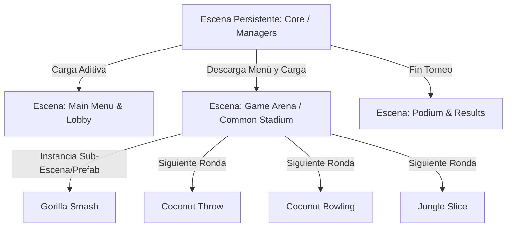
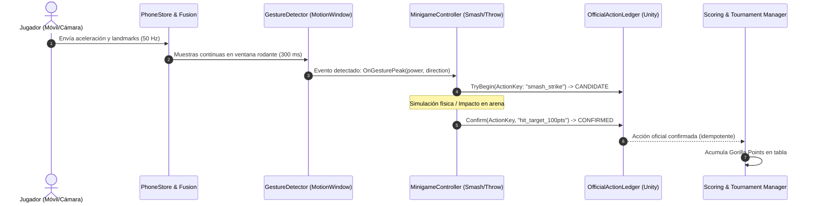

# Auditoría de Arquitectura Unity — Lead Game Developer
**Proyecto:** Gorilla Escape: Gorilimpiadas  
**Rol:** Lead Unity Game Developer & Game Systems Architect  
**Fecha:** 2026-10-14  
**Objetivo:** Auditar la base técnica del proyecto Unity para garantizar que soportará la producción de los cuatro minijuegos (*Gorilla Smash*, *Coconut Throw*, *Coconut Bowling*, *Jungle Slice*) y el flujo de torneo del Academic MVP con estándares de producción.

---

## 1. Estructura del Proyecto y Ensamblados (asmdefs)

### 1.1 Organización de Ensamblados Actual
El proyecto cuenta actualmente con una jerarquía de asmdefs limpia pero demasiado centralizada:
- `GorillaEscape.Contracts.asmdef` (`Shared/CSharp/Runtime`): DTOs puros, codecs y wire contracts. Configurado con `"noEngineReferences": true`. Excelente práctica.
- `GorillaEscape.Runtime.asmdef` (`Unity/Assets/_Project/Scripts`): Contiene todo el código de runtime actual (Core, Input, Network, CameraTracking).
- `GorillaEscape.Editor.asmdef`: Herramientas de Editor y scripts de compilación (`FoundationSetup.cs`).
- `GorillaEscape.EditModeTests.asmdef` y `GorillaEscape.PlayModeTests.asmdef`: Pruebas automatizadas.

### 1.2 Riesgo de Escalamiento a Cuatro Minijuegos
Tener todo el código de runtime en un único ensamblado (`GorillaEscape.Runtime`) provocará acoplamiento y tiempos de compilación lentos cuando se agreguen los 4 minijuegos, la UI, los modelos 3D y el audio.
**Propuesta de Modularización para Phase 1:**
```
Unity/Assets/_Project/Scripts/
├── Core/                -> GorillaEscape.Core.asmdef (Ciclo de vida, Audio, Settings)
├── Input/               -> GorillaEscape.Input.asmdef (Stores, Fusion, Ledger, Gestos)
├── Network/             -> GorillaEscape.Network.asmdef (IPC, Supervisores)
├── Gameplay/
│   ├── Common/          -> GorillaEscape.Gameplay.Common.asmdef (Base minijuegos, Torneo, Reglas)
│   ├── GorillaSmash/    -> GorillaEscape.Minigames.Smash.asmdef
│   ├── CoconutThrow/    -> GorillaEscape.Minigames.Throw.asmdef
│   ├── CoconutBowling/  -> GorillaEscape.Minigames.Bowling.asmdef
│   └── JungleSlice/     -> GorillaEscape.Minigames.Slice.asmdef
└── UI/                  -> GorillaEscape.UI.asmdef (HUDs, Menús, Dashboard)
```

### 1.3 Estado de Paquetes (`manifest.json`)
En [manifest.json](file:///home/josuegalvan/Documentos/Repos/Gorilla-Escape-audit/Unity/Packages/manifest.json), el proyecto tiene dependencias mínimas:
- `com.gorillaescape.contracts` (local)
- `com.unity.test-framework`
- `com.unity.modules.jsonserialize`

**Brecha Crítica:** No está declarado el paquete de interfaz de usuario (`com.unity.ugui` o UI Toolkit). Tampoco TextMeshPro. Para construir los menús, calibración, HUDs deportivos y tablas de clasificación de los 4 juegos, se debe incorporar formalmente el stack de UI.

---

## 2. Ciclo de Vida y Bootstrap

### 2.1 Estado Actual
En [Bootstrap.cs](file:///home/josuegalvan/Documentos/Repos/Gorilla-Escape-audit/Unity/Assets/_Project/Scripts/Core/Bootstrap.cs), la inicialización es trivial:
```csharp
private void Awake() {
    Application.targetFrameRate = settings.TargetFrameRate;
}
```
Los servicios auxiliares (`JavaProbeSupervisor` y `VisionSupervisor`) son instanciados por scripts de diagnóstico mediante `[RuntimeInitializeOnLoadMethod(RuntimeInitializeLoadType.AfterSceneLoad)]` dependiendo de variables de entorno del sistema operativo (`GORILLA_IPC_JAVA`, `GORILLA_CAMERA_ENABLED`).

### 2.2 Problemas Detectados
1. **Arranque dependiente de variables de entorno:** Si el ejecutable de Unity se lanza directamente sin el script envoltorio `run-base.sh`, los supervisores de Java y Visión **no inician**.
2. **Falta de un Orquestador de Servicios (Service Coordinator):** No existe un punto único que reporte el estado de salud conjunto (si Java falló, si la cámara está desconectada, o si el puerto está ocupado).
3. **Manejo de Cierre:** Los supervisores capturan `Application.wantsToQuit` e interceptan el cierre para enviar señales SIGTERM/Kill a los subprocesos. Este mecanismo funciona bien en el laboratorio, pero en `IpcProbeRunner.cs` se usa `async void OnDestroy()`, lo cual es un antipatrón en Unity (las corrutinas o tareas async no controladas continúan ejecutándose tras la destrucción del objeto).

---

## 3. Arquitectura de Escenas

### 3.1 Situación Actual
Existe una única escena: [Bootstrap.unity](file:///home/josuegalvan/Documentos/Repos/Gorilla-Escape-audit/Unity/Assets/_Project/Scenes/Bootstrap/Bootstrap.unity). No contiene cámaras, ni Canvas, ni iluminación configurada.

### 3.2 Arquitectura Recomendada para el Torneo Completo
Para evitar el "monolito de una sola escena" y el abuso de `DontDestroyOnLoad`, se debe adoptar una arquitectura de **Carga Aditiva de Escenas (Additive Scene Loading)**:



- **Escena Core (Persistente):** Contiene el `GameManager`, supervisores de red/cámara, audio global y almacenes de entrada (`PhoneInputStore`, `OfficialActionLedger`). Nunca se descarga.
- **Escenas de Gameplay:** Se cargan aditivamente mediante `SceneManager.LoadSceneAsync(..., LoadSceneMode.Additive)`. Esto aísla la memoria de texturas y mallas 3D de cada disciplina y evita fugas entre rondas.

---

## 4. Calidad de MonoBehaviours, Update Loop y Memoria GC

### 4.1 Hotspots y Antipatrones Detectados en Código de Phase 0

1. **Llamadas síncronas a disco en `Update()`:**  
   En `CameraFusionLabRunner.cs`:
   ```csharp
   string path=Environment.GetEnvironmentVariable("GORILLA_FUSION_COMMAND");
   if(!string.IsNullOrEmpty(path)&&File.Exists(path)) { ... File.ReadAllText(path) ... }
   ```
   *Riesgo:* I/O síncrono bloqueante en el frame principal de Unity. Provoca microstuttering.

2. **Búsqueda repetida en jerarquía (`FindFirstObjectByType`):**  
   En `CameraFusionLabRunner.cs` líneas 38 y 51, se invoca `FindFirstObjectByType<IpcProbeRunner>()` cada fotograma.  
   *Solución:* Cachear la referencia en `Awake()` / `Start()` o inyectarla vía Service Container.

3. **Asignaciones de Memoria (GC Spikes) en el Bucle de Entrada:**  
   - En `JavaProbeSupervisor.cs`: En cada mensaje IPC (50 veces por segundo), se crean nuevos arrays de bytes y strings UTF8 (`IpcFrameCodec.Read/Write`).
   - En `InputFusion.cs`: `Evaluate()` crea una nueva instancia de `InputFusionFrame`, listas temporales (`new List<string>()`) y llama a `signals.ToArray()` en cada evaluación.
   *Riesgo:* En una sesión de torneo de 4 jugadores durante 15 minutos, esto genera decenas de miles de objetos efímeros que activan el Garbage Collector de Unity provocando tirones de frames (frame drops).
   *Solución:* Reutilizar structs o pools de instancias pre-asignadas (`InputFusionFramePool`).

---

## 5. Estrategia de ScriptableObjects para Tuning Deportivo

Los 4 minijuegos requieren calibración física y deportiva fina. Ninguna constante matemática de potencia, ángulo o tolerancia debe estar "hardcodeada" en el código C#.

Se recomienda crear los siguientes ScriptableObjects:
1. `SmashTuningData.cs`: Umbrales de aceleración mínima para golpe válido, multiplicadores de fuerza según velocidad vertical, curvas de puntuación por impacto.
2. `ThrowTuningData.cs`: Ángulo óptimo de despegue (ej. 45°), ventana de tolerancia de timing al soltar el dedo, resistencia de viento simulada.
3. `BowlingTuningData.cs`: Sensibilidad de desviación lateral (yaw), coeficientes de fricción del carril, cálculo de giro (spin) según giroscopio.
4. `SliceTuningData.cs`: Velocidad angular mínima de corte, tolerancia de plano (horizontal, vertical, diagonal), grosor del collider de corte.
5. `TournamentScoringRules.cs`: Asignación de Gorilla Points por lugar (ej. 1º: 10 GP, 2º: 6 GP, 3º: 4 GP, 4º: 2 GP) y reglas de desempate.

---

## 6. Arquitectura de Entrada y Reconocimiento de Gestos

### 6.1 El Problema Actual: Solo Fotograma Único (`latest`)
En [PhoneInputStore.cs](file:///home/josuegalvan/Documentos/Repos/Gorilla-Escape-audit/Unity/Assets/_Project/Scripts/Input/PhoneInputStore.cs#L8), el almacén guarda:
```csharp
private readonly Dictionary<int,PhoneInputWire> latest;
```
Esto es excelente para interfaces que solo necesitan saber la orientación actual. Sin embargo, **un golpe (Smash), un lanzamiento (Throw) o un corte (Slice) NO son estados instantáneos, sino eventos dinámicos temporales**.

### 6.2 Solución Requerida para Phase 1: `MotionHistoryBuffer` y `GestureDetector`
Se debe implementar un componente intermedio en Unity:
```csharp
public sealed class MotionHistoryBuffer {
    // Almacena muestras de los últimos 500 ms por jugador (~25 muestras a 50 Hz)
    public void Push(int playerId, PhoneInput sample);
    public ReadOnlySpan<PhoneInput> GetWindow(int playerId, float durationSeconds);
    public float GetPeakAcceleration(int playerId, Vector3 direction);
    public float GetAngularVelocitySum(int playerId);
}
```
Con este buffer:
- *Gorilla Smash* detecta la aceleración pico hacia abajo (`-Vector3.up`) en una ventana de 250 ms.
- *Coconut Throw* calcula la derivada del ángulo de inclinación justo antes del evento `TouchReleased`.
- *Coconut Bowling* evalúa la suavidad de la curva pendular en un lapso de 400 ms.
- *Jungle Slice* verifica que la trayectoria espacial cruzó el objetivo con velocidad angular suficiente.

### 6.3 Habilitación de Fallback (T060/#104)
El requisito académico exige que el juego pueda calibrarse, probarse y jugarse sin dispositivos móviles si fallan los teléfonos o la cámara.
Para lograrlo sin alterar la lógica de los 4 minijuegos, se debe definir una abstracción:
```csharp
public interface IPlayerInputSource {
    bool TryGetInput(int playerId, out PlayerMotion motion, out PlayerActions actions);
}

// Implementaciones:
// 1. MobileAndFusionInputSource (usa PhoneInputStore + InputFusion)
// 2. KeyboardFallbackInputSource (flechas/WASD + barra espaciadora para simular gestos)
// 3. FixtureReplayInputSource (para QA automatizado)
```
De esta forma, los minijuegos leen siempre de `IPlayerInputSource` sin saber si los datos provienen de un iPhone físico o del teclado de la PC anfitriona.

---

## 7. Plan de Implementación de los Cuatro Minijuegos



### 7.1 Gorilla Smash
- **Fase de Preparación:** El jugador levanta los brazos. La cámara (`PlayerLock`) confirma que el jugador está en posición erguida.
- **Detección:** Golpe descendente rápido. `GestureDetector` detecta aceleración vertical > umbral `minSmashAcc` en eje Y.
- **Resultado:** La potencia se calcula según la aceleración máxima integrada y la altura del cuerpo. Se aplica impacto a los objetivos en pantalla.

### 7.2 Coconut Throw
- **Fase de Preparación:** Jugador presiona la pantalla del teléfono con el pulgar (`touch.pressed = true`).
- **Detección:** Balanceo hacia adelante. Al soltar el pulgar (`touch.pressed = false`), se calcula la velocidad tangencial y el ángulo de elevación a partir del giroscopio del móvil.
- **Resultado:** Se lanza el coco con física de proyectil balístico (gravedad, impulso inicial y spin).

### 7.3 Coconut Bowling
- **Fase de Preparación:** Jugador adopta postura de bolos (cámara detecta flexión de cuerpo).
- **Detección:** Swing pendular bajo. Se evalúa la velocidad angular en el plano sagital y la desviación en el eje horizontal.
- **Resultado:** Rodamiento del coco por la pista simulada colisionando con los bolos mediante `Rigidbody` y `PhysicMaterial`.

### 7.4 Jungle Slice
- **Fase de Preparación:** Objetos lanzados al aire en la pantalla.
- **Detección:** Movimientos rápidos de corte. El giroscopio detecta cambios bruscos de orientación angular; la posición de la mano en cámara delimita el cuadrante de la pantalla donde se realiza el corte.
- **Resultado:** Si el raycast del corte interseca el collider del objeto dentro de la ventana de tiempo, se corta el fruto y se otorgan puntos según la precisión del ángulo.

---

## 8. Veredicto y Recomendaciones de Lead Unity Developer

### Veredicto: **B — APTO CON REFUERZO PREVIO (READY WITH MINOR HARDENING)**
La arquitectura de datos de Unity es sólida en su base de contratos y autoridad. No hay monolitos insalvables ni singletons tóxicos imposibles de refactorizar.

### Acciones Obligatorias antes de iniciar Phase 1:
1. **Crear `GorillaEscape.Input.Gestures`:** Implementar el buffer rodante de 500 ms y los detectores de picos de aceleración y ángulo.
2. **Implementar `IPlayerInputSource`:** Asegurar el camino para el fallback de teclado/gamepad requerido por la especificación académica (T060).
3. **Limpiar el runner de laboratorio:** Eliminar lecturas síncronas de archivos en `Update()`.
4. **Agregar `com.unity.ugui` al `manifest.json`:** Formalizar la inclusión del stack de UI oficial de Unity.
